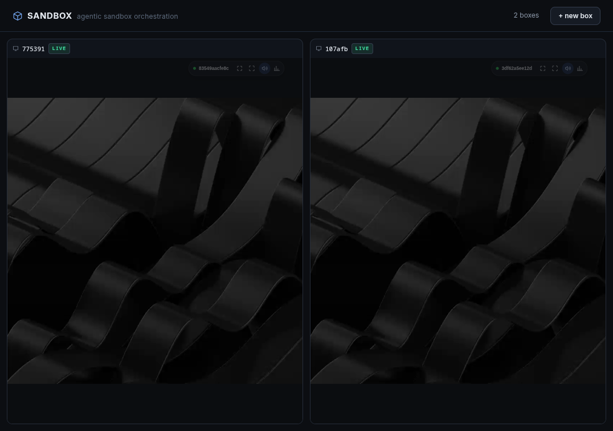

# sbox-b — the sandbox backend

The headless half of **sbox**: it owns the container lifecycle, the AJCS
orchestration API, and the two agent planes. It serves no HTML — the wall UI
is [`sbox-a`](../sbox-a), which proxies `/api/*` here.



Each tile is a live Alpine desktop streaming H.264 over a WebSocket, served by
`cua-spacesd` inside the container.

## Stack

| Component | Inside the container | On the host |
|-----------|----------------------|-------------|
| **Display server** | Xvfb (no network listener) | — |
| **Window manager** | Openbox 3.6 (Turquoise-Nights) | — |
| **Terminal** | Terminator | — |
| **Browser** | Chromium | — |
| **JS runtime** | Bun | — |
| **Audio** | PipeWire (null sink `cua_desktop` + virtual mic) | — |
| **Agent daemon** | cua-spacesd :3211 MCP/gRPC + :3212/udp QUIC | — |
| **Guest exec** | execd :3213 (one `bash` tool, pi semantics) | — |
| **Human viewer** | cua-spacesd `/viewer` (H.264+Opus over WS) | sbox-a tiles iframe it |

## Run it

```bash
./desktop/build-spacesd.sh                        # 1. the guest daemon (once)
podman build -t alpine-desktop:spacesd -f desktop/Containerfile desktop/
cargo build && ./target/debug/sbox-b              # 2. the backend  :3000
cd ../sbox-a && ./dev.sh                          # 3. the wall     :3010
```

Then open <http://127.0.0.1:3010/> and click **+ new box**.

`HOST` and `PORT` override the bind (default `127.0.0.1:3000`).
`SANDBOX_IMAGE` overrides the image the wall filters on and creates from.

## The API

### Wall plane (what sbox-a calls)

```
GET    /api/containers              list sandbox containers + readiness
POST   /api/containers              create + start one
DELETE /api/containers/:id          stop + delete
GET    /api/containers/:id/viewer   mint a fresh viewer ticket → iframe URL
GET    /api/config                  the SPA's slice of config.yaml
GET    /healthz
```

### Orchestration plane (AJCS — `docs/orchestration-contract.md`)

```
POST   /api/orchestration/sandboxes       create + boot (202, then poll)
GET    /api/orchestration/sandboxes       list tracked sandboxes (no tokens)
GET    /api/orchestration/sandboxes/:id   detail (includes the sandbox token)
DELETE /api/orchestration/sandboxes/:id   stop + delete (volumes persist)
GET    /api/orchestration/healthz
```

The lifecycle is a background pipeline: `creating → starting → cloning →
ready`, persisted to `tmp/orchestration-state.json` and reconciled against the
container CLI on every read — the CLI is the source of truth for whether a
sandbox still exists.

### Agent planes (`docs/mcp-driver-contract.md`, `docs/execd-contract.md`)

```
GET  …/sandboxes/:id/mcp/tools         spacesd tools/list  (~73 desktop tools)
POST …/sandboxes/:id/mcp/tools/:name   spacesd tools/call
POST …/sandboxes/:id/mcp/rpc           JSON-RPC passthrough
GET  …/sandboxes/:id/exec/tools        execd tools/list    (bash, read, write)
POST …/sandboxes/:id/exec/tools/bash   execd tools/call
POST …/sandboxes/:id/exec/rpc          JSON-RPC passthrough
```

One HTTP request = one MCP request. The driver holds no session state: the
initialize handshake runs per request, and the per-sandbox bearer token is
recomputed as `HMAC-SHA256(.cua-secret, containerId)` — never persisted,
never echoed.

## Layout

```
sbox-b/
├── src/
│   ├── main.rs                   route table (order matters — see below)
│   ├── config.rs                 config.yaml (a small YAML subset)
│   ├── util.rs                   ports, randomness, timestamps
│   ├── http/{server,client}.rs   hand-rolled HTTP/1.1, both directions
│   └── api/
│       ├── container_cli.rs      THE RUNTIME PORT — Apple `container` ⇄ podman
│       ├── containers.rs         lifecycle, HMAC tokens, readiness, viewer URLs
│       ├── handlers.rs           the wall plane
│       ├── orchestration*.rs     AJCS lifecycle, validation, volumes, store
│       ├── mcp_driver.rs         the two agent facades
│       ├── spacesd.rs            gRPC-Web + hand-rolled protobuf (viewer tickets)
│       └── snapshots.rs          best-effort desktop PNG capture
├── desktop/                      the guest image (Containerfile + assets)
├── docs/                         the three API contracts
└── spike/                        upstream reference material — see spike/README.md
```

Routes are matched by prefix **in registration order**, so the two
orchestration entries must precede the `/api/` catch-all; the catch-all would
otherwise 404 them.

## Container runtimes

The code speaks one dialect — Apple Containers' `container` argv — and
`src/api/container_cli.rs` translates it. `SANDBOX_RUNTIME` forces a choice;
otherwise it takes the first of `container`, `podman`, `docker` on `PATH`.

| Apple `container` | podman / docker |
|---|---|
| `ls` (table) | `ps --format json`, re-emitted as that table |
| `inspect` | `inspect`, reshaped to `[{status.state, configuration.publishedPorts}]` |
| `-c <n>` | `--cpus <n>` (podman's `-c` is cpu-shares, a different knob) |
| `-p h:g` | `-p 127.0.0.1:h:g` (Apple publishes on loopback only) |
| image `foo:bar` | `localhost/foo:bar`, normalized back |

`create`, `start`, `stop`, `rm`, `exec` and `volume create` are already
compatible and pass through untouched.

Container eth0 addresses are not routable from the host on either runtime, and
rootless podman gives the container no host-visible address at all (the wall
shows `-`). Everything reaches a box through its published loopback ports.

## Gotchas

### A musl build of cua-spacesd is headless unless patched
Upstream treats **any musl build as the static headless guest daemon**:
`crates/cua-spacesd/build.rs` sets a `cua_headless` cfg when the target env is
musl, and the manifest then drops `cua-spacesd-desktop`, `cua-spacesd-doctor`
and `platform-linux`. An unpatched Alpine build stubs Computer, Windows,
Accessibility, Stream and Presence: the viewer reports *"this cua-spacesd build
has no desktop provider"* and `/mcp tools/list` answers 501. This is not
Linux-specific — an arm64 Alpine build on a Mac is headless the same way.

`desktop/build-spacesd.sh` un-gates it, and separately restores the viewer CSP
relaxation (upstream hardcodes `frame-ancestors 'none'`, which blanks every
wall tile while a standalone viewer tab renders fine). Both patches fail the
build loudly if upstream moves an anchor, rather than silently shipping a
headless or un-embeddable binary again.

Because the desktop build links libX11/Xi/Xtst/xkbcommon/opus and Alpine ships
no static archives for them, the binary is **dynamically linked** against musl
(`RUSTFLAGS=-C target-feature=-crt-static`) rather than the stock `-static-pie`.
The image installs exactly those libraries.

### Audio is load-bearing for viewer sessions
The browser viewer requests an audio track by default; without PipeWire,
`OpenMedia` fails wholesale and the viewer never attaches (silent black canvas
+ retry loop). The image ships headless PipeWire (`start-audio.sh`); don't
remove it. `&audio=none` in the viewer hash is the escape hatch — `audio=off`
only mutes, it still requests the track.

### Viewer tickets are minted fresh per tile load
They are short-lived, single-flow credentials. Reusing one across rapid
reloads is unreliable, so the SPA re-mints on READY transitions and tile
(re)mounts. The browser never sees the env token.

### The APK cache is opt-in
`--build-arg APK_CACHE=http://192.168.64.1:3142` points the image build at a
local Alpine mirror. That address is the host side of the Apple VM bridge; on
a Linux host it routes out the default gateway and stalls every apk index
fetch until it times out, so it is off by default.

### Named volumes mount root-owned
A fresh `container volume create` volume is owned by root, and the guest
session runs as `desktop` — so a sandbox cannot write to its own mount until
something chowns it. Pre-existing behaviour, not runtime-specific.

### machine-id is baked into the image
spacesd's machine identity comes from `/etc/machine-id`, generated once at
image build, so every container from an image reports the same id. Cosmetic
for single-user loopback; regenerate per container in the entrypoint if it
ever matters.

## Related

- [`sbox-a`](../sbox-a) — the wall UI (Rust → wasm) that drives this backend.
- [github.com/mikesmullin/sandbox](https://github.com/mikesmullin/sandbox) —
  the predecessor: a feature-dense multi-pod K8s sandbox with tiled desktop
  streaming, GitLab, GPU passthrough and an MCP host-coordinator. sbox trades
  that density for one container runtime and a viewer that looks right.
